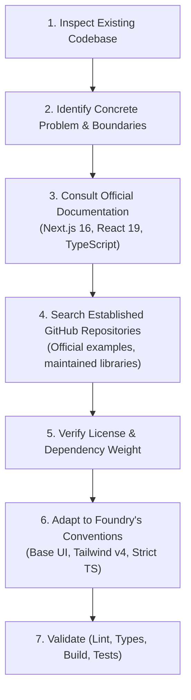
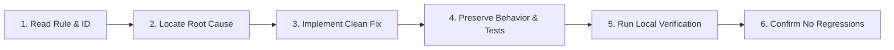
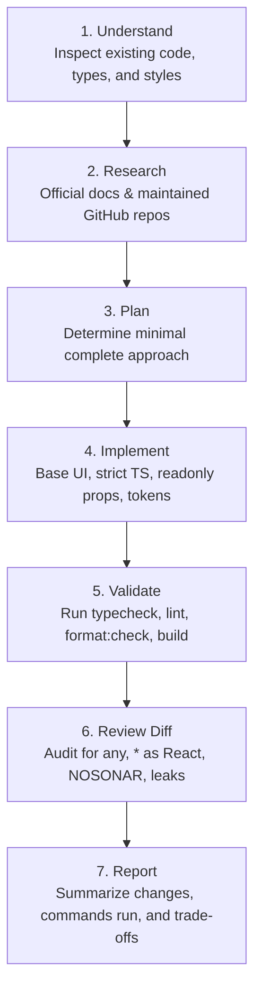

# Foundry Agent Instructions (`AGENTS.md`)

> **Primary Operating Manual for Autonomous Coding Agents and AI Assistants**  
> Repository: `foundry` | Framework: Next.js 16 (App Router) | Runtime: React 19 & Node.js 24 | Package Manager: `pnpm`

---

## 1. Document Purpose & Operational Mandate

This document is the authoritative instruction manual for all AI coding agents, pair programmers, and automated tooling working in the **Foundry** codebase.

Foundry is a high-performance, developer-grade **AI-powered website builder**. It enables developers and product teams to conceptualize, iterate, preview, and deploy production-ready React/Next.js web applications through conversational AI and code generation.

### Core Agent Mandate

1. **Grounded Reality First:** Base all decisions on inspected codebase realities, verified package scripts, and confirmed dependencies. Never fabricate commands, paths, environment variables, or library capabilities.
2. **Security by Design:** Foundry generates and previews user-supplied and AI-generated code. The boundary between the trusted Foundry builder and untrusted generated applications is absolute and non-negotiable.
3. **Clean Code & SonarQube Compliance:** Quality issues must be resolved at the root cause. Silencing warnings via suppressions (`// NOSONAR`, `@ts-ignore`, `eslint-disable`) is strictly prohibited.
4. **Minimal, Intentional Imports:** Never import entire module namespaces (`import * as React from "react"` is prohibited unless required by a third-party namespace API). Use named imports and `import type`.
5. **Base UI Primitives:** Foundry's shadcn/ui setup is built on top of `@base-ui/react` (`base-nova` style). Triggers use the `render={<Component />}` prop pattern, **never** `asChild`.
6. **Strict Verification:** Always run applicable quality checks (`typecheck`, `lint`, `format:check`, `build`) before concluding any task.

---

## 2. Project Architecture & Confirmed Tech Stack

The following stack represents the verified repository state. Where architectural features are not yet implemented (e.g., ORM, test runner, AI SDK), they are explicitly labeled as **Forward-Looking Requirements**.

### 2.1 Technology Stack Matrix

| Layer / Concern       | Technology & Exact Version                   | Implementation Status    | Grounded Details & Notes                                                                                                                 |
| :-------------------- | :------------------------------------------- | :----------------------- | :--------------------------------------------------------------------------------------------------------------------------------------- |
| **Framework**         | Next.js `16.4.3` (App Router)                | **Active / Confirmed**   | Turbopack loader, Cache Components enabled, Partial Prerendering (`partialPrefetching: true`), `agentFeedback: true`.                    |
| **Runtime & UI**      | React `19.3.0` & React DOM `19.3.0`          | **Active / Confirmed**   | React 19 functional components, Rules of React, `useSyncExternalStore` for external state.                                               |
| **Node.js Target**    | Node.js `>= 20.9.0` (CI uses `24`)           | **Active / Confirmed**   | Target runtime in GitHub Actions CI is Node 24; local development requires `>= 20.9.0`.                                                  |
| **Package Manager**   | `pnpm 12.15.0` (`pnpm-lock.yaml`)            | **Active / Confirmed**   | `pnpm` is the sole authorized package manager. Monorepo workspace config: `pnpm-workspace.yaml`.                                         |
| **Language**          | TypeScript `5.x`                             | **Active / Confirmed**   | `tsconfig.json` has `"strict": true`, `"moduleResolution": "bundler"`, path alias `@/*` -> `./*`.                                        |
| **Styling**           | Tailwind CSS `v4` (`@tailwindcss/turbopack`) | **Active / Confirmed**   | OKLCH semantic tokens, `tw-animate-css`, `@custom-variant dark`, View Transitions theme support.                                         |
| **UI Primitives**     | shadcn/ui + `@base-ui/react 1.9.0`           | **Active / Confirmed**   | Style: `base-nova`. Uses Base UI triggers (`render` prop). Do NOT use Radix `asChild`.                                                   |
| **Icons & Motion**    | `lucide-react 1.62.0`, View Transitions API  | **Active / Confirmed**   | Monochromatic developer-grade iconography; circular clip-path theme animations.                                                          |
| **Theming**           | `next-themes 0.4.6`                          | **Active / Confirmed**   | Hydration-safe theme switching synchronized via `useSyncExternalStore`.                                                                  |
| **Linter**            | ESLint `9.x` (`eslint.config.mjs`)           | **Active / Confirmed**   | Flat config integrating `eslint-config-next` (core-web-vitals + typescript) and `eslint-config-prettier`.                                |
| **Formatter**         | Prettier `3.9.10` (`.prettierrc`)            | **Active / Confirmed**   | Double quotes, 2 spaces, trailing commas `all`, print width 80.                                                                          |
| **Git Hooks**         | Husky `9.1.7` & lint-staged `17.6.0`         | **Active / Confirmed**   | `.husky/pre-commit` runs `pnpm lint-staged` and `pnpm typecheck`.                                                                        |
| **CI / CD**           | GitHub Actions (`.github/workflows/ci.yml`)  | **Active / Confirmed**   | Runs `lint`, `typecheck`, `format:check`, `build` on Node 24 with `pnpm install --frozen-lockfile`.                                      |
| **Testing Engine**    | _Unconfigured_ (Target: Vitest / Playwright) | _Forward-Looking_        | No test runner is currently installed in `package.json`. See [Section 13](#13-testing-strategy--verification-guidelines).                |
| **Database / ORM**    | _Unconfigured_ (Target: PostgreSQL / ORM)    | _Forward-Looking_        | No persistence engine installed yet. See [Section 9](#9-data-database--multi-tenant-integrity).                                          |
| **Authentication**    | _Unconfigured_ (Target: Session/JWT Auth)    | _Forward-Looking_        | Sign-in route stubbed at `/sign-in`. See [Section 7](#7-nextjs-security-rules).                                                          |
| **AI Generation SDK** | _Unconfigured_ (Target: Vercel AI SDK)       | _Forward-Looking_        | Model calling and streaming not yet installed. See [Section 8](#8-foundry-ai--untrusted-generated-code-security).                        |
| **SonarQube**         | Quality profile rules active by policy       | _Forward-Looking Config_ | Sonar properties file not yet committed, but Clean Code standards are mandatory. See [Section 6](#6-code-quality--sonarqube-compliance). |

---

### 2.2 Directory Structure & Module Responsibilities

```
foundry/
├── .agents/                      # Domain-specific coding skills & Vercel engineering guides
│   └── skills/                   # Installed skill definitions (react-best-practices, composition, etc.)
├── .github/                      # GitHub Actions workflows
│   └── workflows/ci.yml          # CI pipeline: install, lint, typecheck, format check, build
├── .husky/                       # Git lifecycle hooks
│   └── pre-commit                # Runs lint-staged and typecheck before commit
├── app/                          # Next.js App Router root
│   ├── favicon.ico               # Application favicon
│   ├── globals.css               # Tailwind v4 theme, OKLCH tokens, view transition reset
│   ├── layout.tsx                # Root layout: Geist fonts, ThemeProvider, TooltipProvider
│   └── page.tsx                  # Foundry landing page & initial prompt composer
├── components/                   # Application React components
│   ├── theme-provider.tsx        # next-themes ThemeProvider wrapper
│   ├── theme-toggle.tsx          # Hydration-safe animated theme toggler trigger
│   └── ui/                       # shadcn/ui components built on @base-ui/react primitives
│       ├── button.tsx            # Button primitive with CVA variants (default, outline, ghost, etc.)
│       ├── credenza.tsx          # Adaptive modal: Dialog on desktop, Drawer on mobile
│       ├── dialog.tsx            # Modal dialog using @base-ui/react/dialog (render prop)
│       └── ... (24 UI primitives)
├── hooks/                        # Shared client hooks
│   └── use-mobile.ts             # Mobile viewport detection via useSyncExternalStore
├── lib/                          # Shared utilities and helpers
│   └── utils.ts                  # Class-name merger (re-exports `cn` from package `cn`)
├── public/                       # Static public assets
├── .lintstagedrc.json            # Lint-staged configuration for git pre-commit
├── .prettierrc                   # Prettier formatting rules
├── .prettierignore               # Prettier ignore patterns (includes .agents, .next, etc.)
├── components.json               # shadcn/ui configuration (base-nova, OKLCH, Base UI)
├── DESIGN.md                     # Single source of truth for UI, theme, tokens, and layout
├── eslint.config.mjs             # ESLint 9 flat configuration
├── next.config.ts                # Next.js 16 configuration (PPR, Turbopack, agentFeedback)
├── package.json                  # Project manifest, verified scripts, and dependencies
├── pnpm-lock.yaml                # Lockfile (pnpm v12)
├── pnpm-workspace.yaml           # pnpm workspace configuration
├── README.md                     # High-level developer documentation and quickstart
├── skills-lock.json              # Version tracking for agent skills
└── tsconfig.json                 # TypeScript compiler configuration (strict mode)
```

---

## 3. Verified Commands & Developer Workflows

Always execute commands through `pnpm`. Do not use `npm`, `yarn`, or `bun`.

### 3.1 Standard Development Scripts

```bash
# Start local development server with Turbopack (default port: 3000)
pnpm dev

# Type check the entire codebase without emitting JavaScript
pnpm typecheck

# Execute ESLint 9 across all project files
pnpm lint

# Verify code formatting against Prettier rules (fails on mismatched formatting)
pnpm format:check

# Automatically format all supported files using Prettier
pnpm format

# Create production build with Next.js Turbopack compiler
pnpm build

# Start production server after building
pnpm start

# Reinitialize Husky Git hooks (runs automatically during pnpm install via prepare)
pnpm prepare
```

### 3.2 Pre-Commit Lifecycle (`.husky/pre-commit`)

Every local `git commit` triggers `.husky/pre-commit`, which automatically executes:

1. `pnpm lint-staged`:
   - Runs `eslint --fix --no-warn-ignored` and `prettier --write` on staged `*.{js,jsx,ts,tsx,mjs,cjs}`.
   - Runs `prettier --write` on staged `*.{json,md,css,scss,html,yaml,yml}`.
2. `pnpm typecheck`:
   - Validates that no TypeScript compiler errors exist anywhere in the project.

### 3.3 CI Pipeline Checks (`.github/workflows/ci.yml`)

To ensure pull requests pass CI, verify that all four checks succeed locally prior to push:

```bash
pnpm lint && pnpm typecheck && pnpm format:check && pnpm build
```

---

## 4. GitHub Research & Feature Engineering Protocol

Whenever designing or implementing a new feature, coding agents must conduct **proportionate research** into official documentation and established GitHub implementations.

### 4.1 Step-by-Step Research Workflow



1. **Inspect Existing Architecture:** Always review Foundry's current abstractions before writing code. Determine if existing utilities in `@/lib`, primitives in `@/components/ui`, or hooks in `@/hooks` solve the problem.
2. **Prioritize Official Documentation:**
   - [Next.js App Router Documentation](https://nextjs.org/docs/app)
   - [React 19 Reference & Rules](https://react.dev/reference/rules)
   - [TypeScript Handbook](https://www.typescriptlang.org/docs/)
   - [Vercel Agent Skills Repository](https://github.com/vercel-labs/agent-skills)
   - Bundled local skills in `.agents/skills/`
3. **Inspect Real-World GitHub Implementations:**
   - Prefer official repositories (e.g., `vercel/*`, `facebook/*`, `shadcn/*`).
   - Examine how production code handles edge cases, concurrency, cleanup, and cancellation.
   - Do not trust GitHub star counts or popularity alone as evidence of security, correctness, or performance.
4. **License & Dependency Screening:**
   - Check the repository's open-source license (MIT, Apache 2.0, BSD are acceptable; avoid copyleft licenses like AGPL/GPL for vendor code).
   - Never add a dependency to solve a problem that can be handled cleanly with 10–20 lines of standard TypeScript or existing utilities.
5. **Transparency Rule:** If web search or repository inspection is unavailable or rate-limited, explicitly state the limitation in your response. Never invent fake repositories, benchmarks, or citations.

---

## 5. TypeScript & React 19 Coding Standards

### 5.1 Import Only What Is Needed (Strict Prohibition on `* as React`)

Never import the entire React namespace when named imports or direct imports are sufficient.

```tsx
// ❌ AVOID: Importing full React namespace
import * as React from "react";

export function Counter() {
  const [count, setCount] = React.useState(0);
  const buttonRef = React.useRef<HTMLButtonElement>(null);

  return (
    <button ref={buttonRef} onClick={() => setCount((c) => c + 1)}>
      {count}
    </button>
  );
}
```

```tsx
// ✅ PREFER: Named imports and direct type imports
import { useState, useRef } from "react";

export function Counter() {
  const [count, setCount] = useState(0);
  const buttonRef = useRef<HTMLButtonElement>(null);

  return (
    <button ref={buttonRef} onClick={() => setCount((c) => c + 1)}>
      {count}
    </button>
  );
}
```

#### Import Rules:

- **Import only used identifiers:** Never import unused variables, hooks, or components.
- **Use `import type`:** Always use `import type { Foo }` for type-only imports to eliminate bundle bloat and circular evaluation.
- **No speculative imports:** Do not import modules for hypothetical future use.
- **Direct file imports over broad barrels:** Where possible, import directly from module paths to assist Turbopack tree-shaking (see `.agents/skills/vercel-react-best-practices` rule `bundle-barrel-imports`).
- **Permitted namespace exceptions:** Third-party libraries that explicitly mandate namespace imports (e.g., certain schema builders or AST parsers) may use namespace imports with a brief inline explanation.

---

### 5.2 TypeScript Strictness & Type Safety

Foundry enforces strict type-checking (`"strict": true` in `tsconfig.json`).

- **No `any`:** Never use `any` to silence compiler warnings. Use `unknown` at untrusted boundaries (network responses, user prompts, dynamic JSON) and narrow safely using type guards or Zod schemas.
- **No Unsafe Type Assertions:** Avoid `as Type` assertions unless working with an external library whose types are demonstrably incomplete. Never chain `as unknown as Foo`.
- **No Non-Null Assertions (`!`):** Avoid `!` unless the invariant is guaranteed by preceding runtime guards.
- **Discriminated Unions for Complex State:** Model asynchronous flows and mutually exclusive states using discriminated unions:
  ```typescript
  type GenerationState =
    | { readonly status: "idle" }
    | {
        readonly status: "generating";
        readonly prompt: string;
        readonly startedAt: number;
      }
    | {
        readonly status: "success";
        readonly code: string;
        readonly completedAt: number;
      }
    | {
        readonly status: "error";
        readonly error: string;
        readonly retryable: boolean;
      };
  ```
- **Use `satisfies`:** Validate data shapes and configurations without discarding specific literal inferences:
  ```typescript
  const config = {
    timeoutMs: 5000,
    retryCount: 3,
  } satisfies Record<string, number>;
  ```
- **No `@ts-ignore` or `@ts-nocheck`:** Never suppress TypeScript diagnostics. If a complex type issue arises, fix the underlying interface or extract a properly typed intermediate function.

---

### 5.3 Readonly Component Props & Immutability

Props and external data contracts passed into components must be marked `Readonly` to reinforce unidirectional data flow and prevent accidental mutation.

```tsx
// ❌ AVOID: Mutable prop contracts and mutating input data
interface ProjectCardProps {
  projectId: string;
  title: string;
  tags: string[];
}

export function ProjectCard({ projectId, title, tags }: ProjectCardProps) {
  tags.sort(); // Dangerous: Mutates parent collection!
  return <div>{title}</div>;
}
```

```tsx
// ✅ PREFER: Readonly props contract and immutable operations
type ProjectCardProps = Readonly<{
  projectId: string;
  title: string;
  description?: string;
  tags?: readonly string[];
  onOpen: (projectId: string) => void;
}>;

export function ProjectCard({
  projectId,
  title,
  description,
  tags = [],
  onOpen,
}: ProjectCardProps) {
  const sortedTags = [...tags].sort((a, b) => a.localeCompare(b));

  return (
    <button
      type="button"
      onClick={() => onOpen(projectId)}
      className="text-left p-4 rounded-lg border border-border bg-card hover:bg-accent/50 transition-colors"
    >
      <span className="font-medium text-foreground">{title}</span>
      {description ? (
        <span className="text-xs text-muted-foreground block mt-1">
          {description}
        </span>
      ) : null}
      {sortedTags.length > 0 ? (
        <div className="flex gap-1 mt-2">
          {sortedTags.map((tag) => (
            <span
              key={tag}
              className="text-[10px] font-mono px-1.5 py-0.5 rounded bg-muted text-muted-foreground"
            >
              {tag}
            </span>
          ))}
        </div>
      ) : null}
    </button>
  );
}
```

#### Immutability Guidelines:

- Apply `Readonly<{ ... }>` or `readonly` properties consistently across UI components and shared data models.
- Treat state as immutable: use functional state updates (`setItems((prev) => [...prev, newItem])`).
- Remember: TypeScript `readonly` is a compile-time check; do not confuse it with runtime sandboxing or security boundaries.

---

### 5.4 React 19 Component Conventions & Base UI

- **Function Components Only:** Use modern React 19 function components.
- **Pure Render Functions:** Do not invoke non-deterministic functions (e.g., `Date.now()`, `Math.random()`, or `crypto.randomUUID()`) directly in the render body.
- **No Component Inlining:** Never define a component inside another component. This destroys internal React state across re-renders:
  ```tsx
  // ❌ AVOID: Component inside component
  function Workspace() {
    const Item = () => <div>Item</div>; // Recreated on every render!
    return <Item />;
  }
  ```
- **Derive Values During Render:** Do not store redundant state that can be computed from existing props or state. Never use `useEffect` to synchronize dependent state.
- **Base UI `render` Prop Convention (Critical!):** Foundry uses `@base-ui/react` primitives. Base UI triggers do **NOT** use Radix's `asChild`. Always use the `render` prop:
  ```tsx
  // ✅ Correct Base UI trigger syntax in Foundry:
  <DialogTrigger render={<Button variant="outline" size="sm" />} />
  <DropdownMenuTrigger render={<Button variant="ghost" size="icon-sm" />} />
  <TooltipTrigger render={<button type="button" className="text-xs" />} />

  // ❌ Incorrect (will fail TypeScript compilation with TS2322):
  <DialogTrigger asChild><Button ... /></DialogTrigger>
  ```
- **External Store Subscriptions:** Use `useSyncExternalStore` for browser APIs, media queries, and window events to guarantee zero hydration mismatch (see [`hooks/use-mobile.ts`](file:///l:/Mohammad%20%20Arfat/course/web%20delepment/files/foundry/hooks/use-mobile.ts)).
- **Complete State Representation:** Every data-driven UI must explicitly account for **Loading**, **Error**, **Empty**, **Success**, and **Disabled** states.

---

### 5.5 Server vs. Client Component Boundaries

- **Server Components by Default:** In the Next.js App Router, all components in `app/` are React Server Components (RSC) unless explicitly marked with `"use client"`.
- **Push `"use client"` to the Leaves:** Add `"use client"` only to small, focused interactive components that require event handlers (`onClick`, `onChange`), browser APIs (`window`, `localStorage`), or client hooks (`useState`, `useRef`).
- **Server Module Isolation:** Never import server-only logic (secrets, filesystem utilities, database drivers) into client components. Next.js enforces this boundary; violating it will break compilation.
- **Minimize Serialization Payload:** Server Components passing props to Client Components must serialize data across the network boundary. Pass only the minimal fields required by the client component, avoiding massive nested JSON trees.

---

## 6. Code Quality & SonarQube Compliance

**SonarQube issues must be fixed at the source. Never hide a problem merely to make the quality gate pass.**

### 6.1 Prohibited Evasion Practices

The following shortcuts are strictly forbidden across the Foundry codebase:

- `// NOSONAR` or any inline lint/sonar suppression comments.
- `eslint-disable` or `eslint-disable-next-line` comments used to silence legitimate defects.
- `@ts-ignore`, `@ts-expect-error` (unless verifying compiler rejection in tests), or `@ts-nocheck`.
- Modifying SonarQube exclusion patterns to hide complex files.
- Weakening quality gate thresholds or ESLint configuration rules to pass CI.
- Replacing concrete types with `any` to bypass type-checker warnings.
- Swallowing errors in empty catch blocks (`try { ... } catch (e) {}`).
- Deleting tests or softening assertions to bypass failing checks.

---

### 6.2 Six-Step Root-Cause Remediation Protocol

When a linter, compiler, or SonarQube issue is reported:



1. **Read the Exact Diagnostic:** Inspect the specific rule ID (e.g., `typescript:S1291`, `typescript:S3776`), error location, and explanation.
2. **Locate the Root Cause:** Determine why the code triggered the issue (e.g., high cognitive complexity, duplicate code branch, unhandled promise rejection).
3. **Refactor the Source:** Restructure the logic cleanly. Break large functions into focused helpers, replace nested ternaries with early returns, or define appropriate union types.
4. **Preserve Contracts:** Ensure public APIs, serialized props, and user-facing behaviors remain fully backward-compatible.
5. **Verify Locally:** Run `pnpm typecheck` and `pnpm lint`.
6. **False-Positive Handling:** If an issue is demonstrably an analysis tool bug or false positive, document the concrete evidence in your response and request team review. Do not unilaterally add an inline suppression.

---

### 6.3 Clean Code Architectural Principles

- **Cognitive Simplicity:** Keep functions small (ideally < 30 lines) with a single, clear responsibility.
- **Early Returns:** Guard conditions at the top of functions to eliminate deep indentation:
  ```typescript
  // ✅ PREFER: Guard clauses
  function processPrompt(prompt: string, isSubmitting: boolean) {
    const trimmed = prompt.trim();
    if (!trimmed || isSubmitting) return;

    // Core processing logic without nesting...
  }
  ```
- **No Magic Values:** Extract unexplained numbers, timeouts, and string identifiers into named, module-scoped constants:
  ```typescript
  const DEFAULT_PROMPT_TIMEOUT_MS = 30_000;
  const MAX_PROMPT_LENGTH_CHARACTERS = 4_000;
  ```
- **Intentional Error Handling:** Always handle promise rejections. In asynchronous operations, capture errors, log structured diagnostic context on the server, and return user-friendly, non-leaking messages.

---

## 7. Next.js Security Rules

Security is a foundational design constraint. Foundry generates and executes web applications; its security perimeter must be impregnable.

### 7.1 Authentication & Authorization

- **Public Entry Points:** Treat every Server Action, Route Handler, and API endpoint as a publicly exposed endpoint.
- **Authorize Every Mutation:** Never rely on middleware, route guards, or hidden UI buttons as your sole access control. Perform session verification and project ownership checks **inside** every Server Action and database query:
  ```typescript
  // Example pattern for Server Actions:
  export async function updateProjectTitle(
    projectId: string,
    newTitle: string,
  ) {
    const session = await getAuthenticatedSession();
    if (!session) {
      throw new Error("UNAUTHORIZED");
    }

    const project = await findProjectById(projectId);
    if (!project || project.ownerId !== session.userId) {
      throw new Error("FORBIDDEN");
    }

    // Perform validated mutation...
  }
  ```
- **Tenant Isolation:** Enforce tenant/organization scoping directly in queries (`WHERE project_id = :id AND org_id = :userOrg`).
- **Fail Closed:** Default to denying access whenever authentication, authorization, or role state cannot be confirmed.

---

### 7.2 Input Validation

- **Server-Side Primacy:** Client-side validation improves user experience; server-side validation is the only security boundary.
- **Validate All Untrusted Data:** Validate route parameters, search params, request bodies, file uploads, and external AI provider outputs using schema validation before processing.
- **Bounds on Ingestion:** Enforce strict size limits on prompt strings, payload bodies, pagination `limit` parameters, and concurrent requests.
- **SSRF Prevention:** If Foundry performs server-side fetching of user-provided URLs (e.g., website reference analysis), validate that the destination host is an allowed public domain and block private IP ranges (`10.0.0.0/8`, `172.16.0.0/12`, `192.168.0.0/16`, `127.0.0.1`, `169.254.169.254`).

---

### 7.3 Secrets & Environment Configuration

- **Zero Secrets in Version Control:** Never commit `.env`, `.env.local`, API keys, database connection strings, or private tokens.
- **Protect `NEXT_PUBLIC_*`:** Never prefix an environment variable with `NEXT_PUBLIC_` unless it is explicitly intended to be bundled into client-side JavaScript sent to every browser.
- **Redact Sensitive Logs:** Never log authorization headers, cookies, API keys, full user prompts (which may contain passwords or PII), or database connection strings.
- **Server Config Boundary:** Access environment variables through a dedicated server-side configuration helper that validates required variables at startup.

---

### 7.4 Cookies & Session Management

- **Secure Cookie Attributes:** In production, all auth session cookies must include:
  `HttpOnly; Secure; SameSite=Lax; Path=/`
- **No Secrets in `localStorage`:** Never store session tokens, JWTs, or sensitive credentials in `localStorage` or `sessionStorage` (vulnerable to XSS).
- **CSRF & Redirect Safety:** Enforce CSRF protection on state-changing requests. Validate OAuth redirect URLs against an explicit whitelist to prevent open redirect vulnerabilities.

---

### 7.5 XSS & Unsafe Rendering

- **Prohibit Unsanitized HTML:** Avoid `dangerouslySetInnerHTML`. If rendering parsed Markdown or user-generated HTML, sanitize strictly using a reputable sanitization library (e.g., DOMPurify) with a strict tag whitelist.
- **Validate Protocols:** When rendering links or iframe sources from user or AI data, allow only `https:` and `http:` protocols. Explicitly reject `javascript:`, `data:`, and `vbscript:` URIs.
- **No Dynamic Code Evaluation:** Never execute strings using `eval()`, `new Function()`, or dynamic `import()` of untrusted runtime strings within the Foundry server process.

---

## 8. Foundry AI & Untrusted Generated Code Security

Because Foundry is an AI website builder that accepts prompts and generates executable web code, its threat model requires **strict isolation between the builder chrome and generated applications**.

```
┌───────────────────────────────────────────────────────────┐
│                    FOUNDRY HOST PROCESS                   │
│  - User authentication & session management               │
│  - Database credentials & billing / account records       │
│  - AI model orchestration & prompt composer               │
└─────────────────────────────┬─────────────────────────────┘
                              │
                [STRICT ISOLATION BOUNDARY]
                (No shared memory, FS, or env)
                              │
┌─────────────────────────────▼─────────────────────────────┐
│                 ISOLATED PREVIEW / SANDBOX                │
│  - Sandboxed iframe with `sandbox` attribute               │
│  - Ephemeral container or WebContainer execution runtime  │
│  - Blocked access to cloud metadata (169.254.169.254)      │
│  - Strict memory, CPU, and execution timeout quotas       │
│  - Zero access to Foundry database, keys, or host tokens  │
└───────────────────────────────────────────────────────────┘
```

### 8.1 Generated Code Sandboxing

- **Never Execute on Host:** Never compile, build, or run arbitrary user-generated or AI-generated applications inside the main Foundry server process.
- **Isolated Runtimes:** Preview applications must run inside an isolated sandbox (e.g., sandboxed `<iframe>` with restricted permissions, client-side WebContainers, or ephemeral micro-VM containers).
- **Network & Metadata Restrictions:** Sandboxes must have no access to private VPC networks, internal microservices, or cloud provider metadata endpoints (e.g., AWS/GCP `169.254.169.254`).
- **Resource Constraints:** Apply strict CPU, memory, execution duration (timeout), and disk storage quotas to generation and preview processes.

---

### 8.2 Safe Archive & File Tree Extraction

When persisting, downloading, or extracting generated codebases:

- **Prevent Path Traversal (Zip Slip):** Validate every relative file path. Reject paths containing `..`, absolute paths (`/etc/passwd`, `C:\Windows`), or null bytes.
- **Ban Malicious Scripts:** Do not execute untrusted `npm install` or package manager lifecycle scripts (`preinstall`, `postinstall`) in unsandboxed environments.
- **Persist Separately:** Store generated application source files in isolated project storage buckets or dedicated project tables, completely separated from Foundry's internal application assets.

---

### 8.3 AI Tool Calling & Prompt Security

- **Treat Model Outputs as Untrusted:** AI model outputs—including structured tool calls and JSON responses—are untrusted inputs.
- **Authorize Every Tool Call:** Validate tool arguments independently. Do not allow a model to specify arbitrary file system paths, execute arbitrary shell commands, or query project IDs belonging to other users.
- **Cost & Rate Controls:** Enforce token limits, timeout budgets, and per-user generation rate limits. Prevent uncontrolled model recursion or infinite generation loops.

---

### 8.4 Publishing & Deployment Security

- **Server-Side Credentials:** Store third-party deployment tokens (e.g., GitHub, Vercel, Netlify) encrypted at rest on the server. Never expose deployment tokens to the client browser.
- **Explicit Deployment Authorization:** Never automatically deploy generated code to a production URL without explicit, authenticated user consent.
- **Validate Webhooks:** Cryptographically verify signatures on all deployment callback webhooks before updating project deployment status.

---

## 9. Data, Database & Multi-Tenant Integrity

_(Forward-Looking Implementation Guidelines)_

When persistence engines and database migrations are introduced to Foundry:

1. **Strict Multi-Tenancy:** Every query accessing projects, prompts, chat sessions, or generated files must include the authenticated user/organization ID in its query predicate.
2. **ACID Transactions:** Use database transactions for multi-record operations that must succeed or fail together (e.g., creating a project record, initializing prompt history, and allocating preview storage).
3. **Prevent N+1 Queries:** Use eager loading, joins, or batching (e.g., DataLoader pattern) to prevent repetitive database roundtrips.
4. **Non-Destructive Migrations:** Schema changes must be backward-compatible and deployed via version-controlled migration files. Never run destructive table drops or column truncations in production.
5. **No Production Access in Tests:** Automated test suites must run against dedicated test containers or in-memory databases, never against production or staging databases.
6. **Concurrency & Idempotency:** Generation requests must use idempotency keys to prevent duplicate billing or race conditions during simultaneous user clicks.

---

## 10. API Design, Asynchronous Operations & Integrations

- **Predictable Error Contracts:** APIs and Route Handlers must return structured JSON responses with explicit HTTP status codes:
  ```json
  {
    "error": {
      "code": "PROJECT_NOT_FOUND",
      "message": "The requested project does not exist or you lack permission to view it."
    }
  }
  ```
- **Timeouts on External Calls:** All `fetch()` requests to external AI providers or services must specify an `AbortSignal.timeout(ms)` to prevent hanging requests.
- **Eliminate Asynchronous Waterfalls:** Parallelize independent asynchronous operations using `Promise.all()`:
  ```typescript
  // ✅ Parallelize independent operations
  const [userProfile, projectMetadata] = await Promise.all([
    fetchUserProfile(session.userId),
    fetchProjectMetadata(projectId),
  ]);
  ```
- **Bounded Concurrency:** Never execute unbounded `Promise.all()` over user-supplied arrays. Use a concurrency limiter (e.g., batching or worker pools) for bulk file operations.
- **Streaming Responses:** When streaming AI generation chunks to the client, use Server-Sent Events (SSE) or Web Streams, handle client disconnects gracefully, and release server resources in `finally` blocks.

---

## 11. Performance Optimization & Vercel React Best Practices

Foundry incorporates the comprehensive performance guidelines maintained in `.agents/skills/vercel-react-best-practices`.

### High-Impact Rules to Follow:

1. **Eliminate Waterfalls (`async-`):**
   - Check cheap synchronous conditions before awaiting remote calls.
   - Start promises early; await them late in API routes and Server Components.
   - Use Suspense boundaries to stream slow UI components without blocking the entire page.
2. **Bundle Size Optimization (`bundle-`):**
   - Avoid re-exporting entire libraries through large barrel files.
   - Use `next/dynamic` to lazy-load heavy client features (e.g., Monaco code editors, canvas visualizers, terminal emulators).
3. **Server-Side Efficiency (`server-`):**
   - Use `React.cache()` for per-request function deduplication during rendering.
   - Never store request-specific state in module-level global variables in RSC/SSR code.
4. **Re-render Optimization (`rerender-`):**
   - Derive state during render rather than synchronizing via `useEffect`.
   - Pass initializer functions to `useState(() => computeExpensiveValue())` for expensive initial calculations.
   - Do not wrap simple primitive calculations in `useMemo` where overhead outweighs benefits.
5. **Layout & Media (`rendering-`):**
   - Use Next.js `<Image>` component for optimized, responsive images.
   - Use `content-visibility: auto` for long, off-screen chat history streams.

---

## 12. Design System & UI Implementation

Foundry's visual identity is codified in [`DESIGN.md`](file:///l:/Mohammad%20%20Arfat/course/web%20delepment/files/foundry/DESIGN.md). Adherence to `DESIGN.md` is mandatory for all UI work.

### 12.1 Core Visual Identity

- **Personality:** Developer-grade, serious, high-precision, and calm (akin to Linear, Vercel, Raycast). Avoid cartoonish SaaS gradients or playful marketing decorations.
- **Typography:** Geist font family (`--font-geist-sans`, `--font-geist-mono`). Monospace for code, models, badges, and metadata.
- **Base Radius:** Compact standard radius of `0.5rem` (8px). Never use pill buttons (`rounded-full`) for standard action buttons; reserve `rounded-full` strictly for status dots and avatars.

### 12.2 Semantic OKLCH Color Tokens

Never hardcode hex values (`#fff`, `#000`), RGB, or raw Tailwind colors (`bg-zinc-900`, `text-black`). Always use semantic tokens mapped to CSS custom variables in `app/globals.css`:

- Canvas: `bg-background`, `text-foreground`
- Elevated Surfaces: `bg-card`, `text-card-foreground`, `border-border`
- Popovers / Dialogs: `bg-popover`, `text-popover-foreground`
- Primary Actions: `bg-primary`, `text-primary-foreground`
- Secondary / Badges: `bg-secondary`, `bg-muted`, `text-muted-foreground`
- Dangerous Actions: `bg-destructive`, `text-destructive-foreground`
- Interactive Focus: `focus-visible:ring-2 focus-visible:ring-ring/50`

### 12.3 Builder vs. Preview Visual Boundary

To prevent user confusion, the **generated application preview** must be housed within an explicit, framed card surface (`bg-card border-border`) with a mock browser address bar, maintaining visual separation from the Foundry builder navigation.

### 12.4 Theme Parity & View Transitions

- Light and dark modes must maintain equal contrast and intentionality.
- Theme switching is controlled via `components/ui/animated-theme-toggler.tsx`, utilizing the native **View Transitions API** (`document.startViewTransition`) with dynamic circular expansion from click coordinates.

### 12.5 Accessibility (a11y)

- **Keyboard Navigation:** Every interactive button, dropdown, and tab must be reachable and operable via keyboard (`Tab`, `Enter`, `Space`, `Escape`, arrow keys).
- **Screen Reader Labels:** All icon-only buttons must provide accessible descriptions via `<span className="sr-only">Description</span>` or `aria-label`.
- **Contrast & Motion:** Respect user `prefers-reduced-motion` settings. Ensure WCAG AA contrast compliance across both themes.

---

## 13. Testing Strategy & Verification Guidelines

### 13.1 Current Status & Testing Trajectory

- **Current State:** No test runner (Jest, Vitest, or Playwright) is currently configured in `package.json`.
- **Policy:** Do not claim tests have passed until an official test suite is integrated. When adding features, structure code into pure, decoupled, easily testable functions.

### 13.2 Testing Standards (When Test Suite is Integrated)

When a test framework is added:

1. **Behavioral Focus:** Test observable system behavior and contracts rather than internal implementation details.
2. **Security & Boundary Tests:**
   - Test authentication and unauthorized rejection for all Server Actions and Route Handlers.
   - Test input validation schemas against malformed, excessive, and malicious payloads.
   - Test tenant isolation (ensuring User A cannot query or mutate User B's projects).
   - Test path traversal guards on file extraction utilities.
3. **Mock External Providers:** Never make real network requests to external AI APIs (OpenAI, Anthropic) or payment providers during automated tests. Mock providers with deterministic fixture data.
4. **Zero Flakiness:** Eliminate dependencies on wall-clock race conditions or arbitrary `setTimeout` delays.

---

## 14. Package Management & Git Hygiene

### 14.1 Package Management with `pnpm`

- **Single Lockfile:** Use `pnpm` exclusively. Never run `npm install`, `yarn`, or `bun`.
- **Reproducible Installs:** CI relies on `pnpm install --frozen-lockfile`. Never manually edit `pnpm-lock.yaml`.
- **Evaluating New Packages:** Before proposing a new dependency:
  1. Inspect bundle size impact using bundle analysis tools.
  2. Verify active maintenance and responsive vulnerability patching.
  3. Confirm the license is permissive (MIT, Apache-2.0, BSD).
  4. Ensure the functionality cannot be achieved with built-in framework features.

### 14.2 Git Working Tree Discipline

- **Inspect Status First:** Always run `git status` before touching files to identify uncommitted user modifications.
- **Preserve Unrelated Changes:** Never overwrite or revert files modified by the user outside the task scope (e.g., user additions in `.prettierignore`).
- **Scoped Commits:** Keep modifications strictly relevant to the assigned task. Do not perform sweeping unsolicited reformatting across untouched files.
- **No Unauthorized Git Operations:** Do not create branches, commit, push, or rewrite Git history unless explicitly directed by the user.

---

## 15. Task Execution Workflow

Every coding task must follow this disciplined seven-step lifecycle:



### 1. Understand

Inspect the relevant files, existing abstractions, and current behavior. Identify any active constraints in `package.json`, `tsconfig.json`, or `DESIGN.md`.

### 2. Research

For new patterns or external integrations, consult official documentation and established GitHub implementations. Ensure version compatibility with Next.js 16 and React 19.

### 3. Plan

Formulate the cleanest, simplest implementation plan. Choose the smallest set of files to touch. Avoid introducing unnecessary abstractions, layers, or dependencies.

### 4. Implement

Write idiomatic, maintainable code:

- Import only what is needed (no `import * as React`).
- Mark component props `Readonly<{ ... }>`.
- Use Base UI `render` prop syntax for triggers.
- Use OKLCH semantic tokens from `DESIGN.md`.
- Ensure Server Component defaults and small Client Component boundaries.

### 5. Validate

Run the actual verification suite:

```bash
pnpm typecheck
pnpm lint
pnpm format:check
pnpm build
```

Never report a check as passing if it was not run.

### 6. Review Diff

Audit your changes against this checklist:

- [ ] No `import * as React` (named imports used).
- [ ] No `any`, `@ts-ignore`, or `@ts-nocheck`.
- [ ] No `// NOSONAR` or unjustified `eslint-disable`.
- [ ] No hardcoded hex colors or raw background classes (semantic tokens used).
- [ ] No Radix `asChild` (Base UI `render` prop used).
- [ ] No secrets or sensitive environment variables exposed to the client.
- [ ] All errors intentionally handled with structured responses.
- [ ] No unrelated files modified.

### 7. Report

Deliver a concise, transparent summary:

- Key files created or modified.
- Why the approach was chosen.
- Verification commands executed and their exact exit status.
- Any trade-offs or pending follow-ups.

---

## 16. Handling Edge Cases & Exceptional Situations

1. **Architectural Conflicts:** If a requested requirement contradicts Next.js 16/React 19 constraints, Base UI patterns, or security requirements, explain the trade-off clearly and implement the safer, version-compatible solution.
2. **False Positives in Static Analysis:** If a lint or quality rule flags an indisputable false positive, document the exact rule ID, provide technical evidence, and seek explicit authorization before modifying configuration. Never use `// NOSONAR` or inline suppressions.
3. **Third-Party Service Costs:** Never initiate actions that incur cloud billing, provision paid APIs, or charge credit cards without explicit user approval.
4. **Integrity Rule:** Never fabricate command outputs, mock build results, or invent fictitious documentation. Absolute honesty about codebase state is required at all times.

---

## 17. Reference Sitemap & Installed Agent Skills

To maintain brevity, specialized workflows are delegated to dedicated skills located in `.agents/skills/`:

| Skill Directory                                                                                                                                                          | Description & Purpose                                                                   |
| :----------------------------------------------------------------------------------------------------------------------------------------------------------------------- | :-------------------------------------------------------------------------------------- |
| [`.agents/skills/vercel-react-best-practices/`](file:///l:/Mohammad%20%20Arfat/course/web%20delepment/files/foundry/.agents/skills/vercel-react-best-practices/SKILL.md) | 70 prioritized React/Next.js performance optimization rules (waterfalls, bundles, RSC). |
| [`.agents/skills/vercel-composition-patterns/`](file:///l:/Mohammad%20%20Arfat/course/web%20delepment/files/foundry/.agents/skills/vercel-composition-patterns/SKILL.md) | Scalable React composition patterns, compound components, and render props.             |
| [`.agents/skills/next-bundle-optimizer/`](file:///l:/Mohammad%20%20Arfat/course/web%20delepment/files/foundry/.agents/skills/next-bundle-optimizer/SKILL.md)             | Guidance for auditing and reducing initial browser JavaScript load.                     |
| [`.agents/skills/next-dev-loop/`](file:///l:/Mohammad%20%20Arfat/course/web%20delepment/files/foundry/.agents/skills/next-dev-loop/SKILL.md)                             | Runtime verification loop using Next.js MCP and headless browser testing.               |
| [`.agents/skills/frontend-design/`](file:///l:/Mohammad%20%20Arfat/course/web%20delepment/files/foundry/.agents/skills/frontend-design/SKILL.md)                         | Guidance for intentional, distinctive visual design without generic defaults.           |
| [`.agents/skills/web-design-guidelines/`](file:///l:/Mohammad%20%20Arfat/course/web%20delepment/files/foundry/.agents/skills/web-design-guidelines/SKILL.md)             | Web interface, accessibility, and usability audit guidelines.                           |
| [`.agents/skills/writing-guidelines/`](file:///l:/Mohammad%20%20Arfat/course/web%20delepment/files/foundry/.agents/skills/writing-guidelines/SKILL.md)                   | Technical prose, documentation voice, and tone review guidelines.                       |
| [`.agents/skills/vercel-optimize/`](file:///l:/Mohammad%20%20Arfat/course/web%20delepment/files/foundry/.agents/skills/vercel-optimize/SKILL.md)                         | Cost and compute optimization on Vercel deployments.                                    |

### Essential External References

- Next.js Documentation: https://nextjs.org/docs/app
- Next.js Production Checklist: https://nextjs.org/docs/app/guides/production-checklist
- Next.js AI Agents Guide: https://nextjs.org/docs/app/guides/ai-agents
- React 19 Documentation: https://react.dev/
- Base UI Documentation: https://base-ui.com/
- SonarQube Clean Code Documentation: https://docs.sonarsource.com/
- AGENTS.md Standard Specification: https://agents.md/
